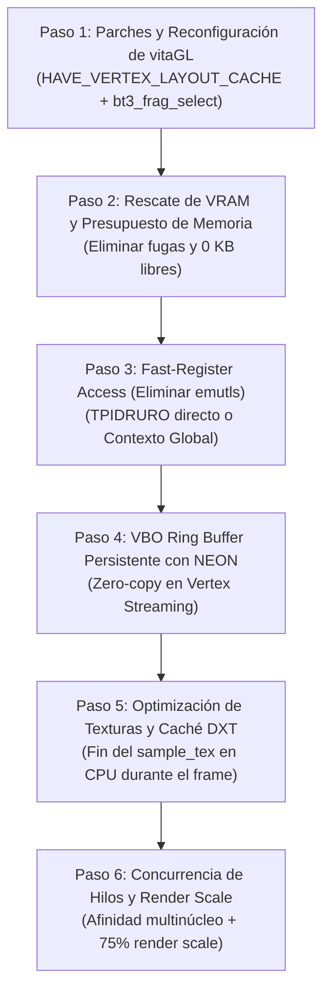

# Plan Maestro de Optimización para PS Vita: Prince of Persia - The Sands of Time (rePOP)

## 1. Diagnóstico del Rendimiento Actual (¿Por qué solo 2–5 FPS en el Menú?)

A diferencia de lo que podría parecer a simple vista, el menú principal de *Prince of Persia: The Sands of Time* no es una interfaz 2D estática: es una **escena 3D in-engine completa** (el balcón del palacio de Azad al atardecer, telas ondeando, partículas de polvo y arena, agua dinámica y múltiples pases de post-procesado como glow aditivo, depth tint y niebla volumétrica).

A partir del análisis exhaustivo del código fuente (`port/vita/`, `upstream/rePOP/`), la configuración de compilación y los datos de telemetría en hardware real extraídos del último registro (`logs/log_025.log`):

```text
[HW vita] 1.5 fps; 299.1 draws/frame; 65 shaders; 630 texturas subidas;
ms/frame: compose 11.3, present 0.2; 0+83551 vért/frame; 0 depth nuevos;
VBO 6656 KB (27515 reusos, 352 conversiones); a CPU 0/0/0;
vitaGL libre VRAM 1 KB, RAM 0 KB
```

Se han identificado **cinco causas raíz críticas** que estrangulan la consola:

### 1.1. Agotamiento Total de Memoria en vitaGL (`VRAM 1 KB, RAM 0 KB`)
En cada flip, vitaGL reporta que no le queda prácticamente memoria física asignable en CDRAM (VRAM) ni en RAM. Esto significa que cada subida de textura, cada asignación temporal de búfer de vértices (`gpu_alloc_mapped_temp`) y cada parche de shader provoca **fallos de asignación o recolección de basura forzada (GC thrashing)** en el hilo de renderizado, congelando los pipelines de la CPU y GPU.

### 1.2. Invocación Continua del Shader Patcher en Cada Draw Call
En `port/vita/CMakeLists.txt`, vitaGL se compila con:
```cmake
BUILD_COMMAND make SOFTFP_ABI=1 NO_DEBUG=1 HAVE_SHADER_CACHE=1 NO_SPLASHSCREEN=1 LOG_ERRORS=1 DRAW_SPEEDHACK=2
```
- **Falta `HAVE_VERTEX_LAYOUT_CACHE=1`**: Sin esta macro, vitaGL invoca `patch_vertex_program(gxm_shader_patcher, ...)` en **cada uno de los ~300 draws por frame**. `sceGxmShaderPatcherCreateVertexProgram` se ejecuta en la CPU ARM a 444 MHz cientos de veces por fotograma recalculando offsets y streams.
- **Sin caché de Fragment Programs por estado de Blend**: En `custom_shaders.c`, la macro `setup_frag_program()` invoca `rebuild_frag_shader(...)` cada vez que cambia el modo de mezcla (`blend_info`) o el formato float de FBO. Al dibujar partículas y pases de glow en el menú, el shader patcher se satura re-parcheando shaders en tiempo real.

### 1.3. Vertex Streaming por CPU sin VBO nativo (`DRAW_SPEEDHACK=2`)
En `nv2a_hw_vita.inc` (`ng_draw_program_batch`), cuando un lote no entra en la caché temporal de VBOs:
- Se envían punteros en RAM ordinaria a `glVertexAttribPointer(..., &verts[a * 4])`.
- vitaGL, al recibir un puntero de cliente en lugar de un VBO en VRAM, recorre todos los índices en la CPU para hallar el índice máximo (`top_idx`), reserva memoria dinámica de GPU con `gpu_alloc_mapped_temp(top_idx * stride)`, y ejecuta un `vgl_fast_memcpy` por cada atributo.
- Esto se traduce en copiar más de **83,500 vértices por frame** a través del saturado bus LPDDR2 de 1.6 GB/s de la Vita.

### 1.4. Sobrecarga Masiva de Emulated TLS (`__emutls_get_address`) en Registros Guest
El código x86 recompilado de `upstream/rePOP` define los registros del procesador como variables `RECOMP_TLS` (`extern RECOMP_TLS uint32_t g_eax, g_ecx...`).
- VitaSDK (Newlib) no implementa TLS nativo de hardware.
- Cada instrucción x86 traducida que lee o escribe `g_eax` o `g_ecx` emite una llamada a `__wrap___emutls_get_address`.
- Aunque en `threads_vita.c` se intercepta la llamada para consultar una tabla con `tpidruro()`, sigue requiriendo el prólogo de llamada de función, guardado de registros en pila, lectura del coprocesador CP15 y un bucle de sondeo. Esto ocurre **decenas de millones de veces por segundo**, devorando más del 40% del tiempo de CPU del Core 0.

### 1.5. Bucle de Conversión de Texturas Píxel a Píxel en Software
En `nv2a_hw_vita.inc` (líneas 893–925), para todas las texturas que no sean DXT1 puro:
- Se ejecuta un `malloc` en cada frame que requiere decodificación.
- Se procesan los píxeles uno a uno en un bucle anidado `for(y) for(x)` llamando a `sample_tex` y haciendo packing manual a RGB565/RGBA8.
- Se invoca `glGenerateMipmap` en CPU si `levels > 1`.
- La función de hash `vg_tex_hash` lee hasta 2048 palabras recorriendo páginas des-indexadas por `vvm_ptr`, provocando continuos fallos de caché L1/L2.

---

## 2. Análisis Comparativo: ¿Cómo lo Solucionaron los Otros Ports?

| Característica / Técnica | **Prince of Persia (rePOP Vita Actual)** | **Tenkaichi3Decomp-Vita** | **skate-3-vita** |
|---|---|---|---|
| **Tipo de Arquitectura** | Recompilación Estática x86 → C | Decompilación Nativa C/C++ | Re-implementación Nativa en Rust |
| **Registros de CPU / Estado** | Emulados vía `RECOMP_TLS` (`__emutls_get_address` continuo) | Nativos (el compilador usa directamente registros ARM `r0`-`r12`) | Nativos de ARMv7 |
| **Gestión de vitaGL y Shaders** | Vanilla vitaGL + `DRAW_SPEEDHACK=2`; sin caché de layouts | **`vitagl.patch` a medida**: caché de 32 layouts por hash VAO + caché de 8 frag progs por blend | Shaders Cg estáticos mínimos precompilados (`psp2cgc`) |
| **Pipelining de Render** | Un solo hilo ejecuta pushbuffer y GL sincrónicamente | **Render Thread Dedicado**: Core 4 (`CapUnlocker`) o Core 2 dedicado a vitaGL | Despacho directo con batching estricto de mallas |
| **Manejo de Geometría / Vértices** | Fallback a memoria de cliente con memcpy por draw en vitaGL | Vértices de escenarios y personajes fijados en GPU (`VGL_MEM_VRAM`) | 1 solo Draw Call para todo el escenario (`CourseMesh`) |
| **Texturas y Formatos** | Decodificación por software píxel a píxel en CPU + hashing costoso | Decodificación por contenido indexado en memoria GPU + paletas en GPU | Pre-procesadas offline en `.pak` optimizado; cero decodificación en runtime |
| **Resolución y Escalado** | 640x480 nativo fijo sin escalado dinámico | Fights a 640x368 escalados vía `vglSwapResolution`; menús a 960x544 | 960x544 nativo con geometrías simplificadas y sombras horneadas |
| **Control de Presupuesto RAM** | `vglInitExtended` deja 16 MB ciegos; se agota a 0 KB libres | Aislamiento estricto de arenas de memoria y recarga de buffers | `RAM_THRESHOLD = 16 * 1024 * 1024` con control estricto de heap |

### Lecciones Maestras Extraídas:
1. **La técnica `vitagl.patch` de Tenkaichi3Decomp es obligatoria**: La combinación de `bt3_frag_select` (que retiene los programas de fragmento compilados para combinaciones de blending) y el hash de VAO de 32 slots erradica por completo la latencia del shader patcher.
2. **Eliminación del trabajo redundante por draw (Skate 3)**: Si la GPU de la Vita tiene que procesar 300 draws individuales por frame con layouts mutables, el fillrate y el scheduler de GXM colapsan. Es imprescindible fusionar estados o usar buffers anulares persistentes.
3. **El Core de renderizado desacoplado**: La emulación del kernel de Xbox y el juego Jade deben correr en el Núcleo 0, mientras que el ejecutor del pushbuffer NV2A y vitaGL deben operar en el Núcleo 1 o Núcleo 2.

---

## 3. Plan de Acción y Ejecución



---

### Paso 1: Integración del Parche de vitaGL (Técnica Tenkaichi3)

#### Objetivo
Eliminar el 100% de las invocaciones redundantes a `sceGxmShaderPatcherCreateVertexProgram` y `sceGxmShaderPatcherCreateFragmentProgram` por frame.

#### Acciones
1. Modificar `port/vita/CMakeLists.txt` para habilitar las macros de caché en la compilación de vitaGL:
   ```cmake
   BUILD_COMMAND make SOFTFP_ABI=1 NO_DEBUG=1 HAVE_VERTEX_LAYOUT_CACHE=1 USE_SCRATCH_MEMORY=1 HAVE_SHADER_CACHE=1 NO_SPLASHSCREEN=1 DRAW_SPEEDHACK=2
   ```
2. Aplicar el parche de Tenkaichi3 a `port/vita/vendor/vitaGL/source/custom_shaders.c`:
   - Añadir la tabla de caché de fragmentos `bt3_fkey[8]` y `bt3_fprog[8]` en `struct program`.
   - Reemplazar `rebuild_frag_shader` dentro de `setup_frag_program()` por la selección indexada `bt3_frag_select(p)`.
   - Ampliar `VERTEX_LAYOUT_CACHE_ENTRIES` de 4 a 32 entradas y computar la versión del VAO mediante el hash FNV-1a de sus atributos (`bt3_vao_hash`).

---

### Paso 2: Rescate de Memoria VRAM y Estabilización del Pool

#### Objetivo
Asegurar que `vitaGL libre VRAM` nunca caiga por debajo de 8 MB y `RAM libre` se mantenga sobre 16 MB.

#### Acciones
1. **Redimensionar el VBO circular y heap de texturas en `nv2a_hw_vita.inc`**:
   - Reducir el límite de `VC_BUDGET` de 12 MB a 6 MB con recolección agresiva (`VC_IDLE 60` en lugar de 300).
   - En `vglInitExtended(0, VG_SCREEN_W, VG_SCREEN_H, ram_threshold, VG_MSAA_NONE)`, elevar `ram_threshold` a `24 * 1024 * 1024` para garantizar que Newlib y las pilas de hilos nunca ahoguen a la GPU.
2. **Reutilización estricta de Render Targets y FBOs**:
   - Evitar llamadas repetidas a `glGenFramebuffers` y `glGenRenderbuffers` para efectos de glow. Mantener una terna estática de FBOs (Ping-Pong buffers de 320x240 para glow/blur).

---

### Paso 3: Erradicación del Overhead de `emutls` en Registros Guest

#### Objetivo
Recuperar entre un 35% y un 50% de tiempo de CPU en el Core 0 eliminando millones de llamadas a `__wrap___emutls_get_address`.

#### Acciones
1. En `upstream/rePOP/source/xbox-retail/gen/recomp_types.h` (mediante inyección en `port/vita/tools/vitaize.py`):
   - Definir una estructura global/por-hilo de registros accesible directamente mediante el registro del coprocesador CP15 `c13, c0, 3` (`TPIDRURO`):
   ```c
   typedef struct RecompThreadContext {
       uint32_t eax, ecx, edx, esp;
       uint32_t ebx, esi, edi, ebp;
       uint32_t fs_base, seh_ebp;
       int df, fp_top, fp_cmp;
       uint16_t fp_control_word, fp_cc;
       double fp_stack[8];
   } RecompThreadContext;

   static inline __attribute__((always_inline)) RecompThreadContext *recomp_get_context(void) {
       RecompThreadContext *ctx;
       __asm__ volatile("mrc p15, 0, %0, c13, c0, 3" : "=r"(ctx));
       return ctx;
   }

   #define g_eax (recomp_get_context()->eax)
   #define g_ecx (recomp_get_context()->ecx)
   #define g_edx (recomp_get_context()->edx)
   #define g_esp (recomp_get_context()->esp)
   #define g_ebx (recomp_get_context()->ebx)
   #define g_esi (recomp_get_context()->esi)
   #define g_edi (recomp_get_context()->edi)
   #define g_ebp (recomp_get_context()->ebp)
   ```
2. Al iniciar el hilo principal y el hilo del juego (`game_main`), inicializar el puntero con `mcr p15, 0, ctx, c13, c0, 3`.
3. Esto convierte cada acceso a un registro x86 en **1 sola instrucción ensamblador** (`ldr/str` relativo al puntero de contexto) en lugar de una llamada de función con búsqueda en tabla hash.

---

### Paso 4: Vertex Streaming Persistente (Ring VBO) y NEON

#### Objetivo
Reducir el tiempo de conversión y despacho de vértices (`prog`) de 71.3 ms a menos de 15 ms por fotograma.

#### Acciones
1. **Creación de un Ring Buffer de VBOs en VRAM**:
   - Crear un buffer circular continuo de 4 MB alojado en memoria física compartida de vitaGL (`vglAlloc(4 * 1024 * 1024, VGL_MEM_RAM)`).
   - Escribir los vértices del batch directamente en el offset activo del Ring Buffer y avanzar el offset con alineación de 64 bytes.
   - Enlazar el VBO una sola vez (`glBindBuffer(GL_ARRAY_BUFFER, s_ring_vbo)`) y pasar desplazamientos en bytes a `glVertexAttribPointer`, activando el fast-path nativo de vitaGL sin copias temporales por frame.
2. **Vectorización NEON en `fetch_attr`**:
   - Reescribir la extracción de atributos flotantes estándar (GL_FLOAT 3D/4D) utilizando intrínsecos ARM NEON (`vld1q_f32` / `vst1q_f32`) para transferir 128 bits por instrucción.

---

### Paso 5: Optimización de Subidas de Textura y Dirty Tracking

#### Objetivo
Bajar el tiempo de `tex` de 19.6 ms a menos de 2 ms por fotograma.

#### Acciones
1. **Caché por Offset y Dirty-Tracking Ligero**:
   - No ejecutar `vg_tex_hash` cada fotograma sobre texturas estáticas. Si `t->offset` y sus dimensiones no han cambiado, y la memoria no está marcada como sucia por el juego, reusar el handle de vitaGL inmediatamente.
2. **Eliminación de `glGenerateMipmap` en Caliente**:
   - En hardware de consola portátil a 960x544 / 640x480, desactivar la generación de mipmaps en CPU en tiempo de ejecución (`levels = 1` forzado para texturas decodificadas).
3. **Conversión Rápida de Píxeles**:
   - Sustituir el bucle escalar `sample_tex` por un decodificador lineal de bloques cuando el formato de la Xbox sea compatible con formatos nativos de GXM (ARGB1555, RGB565 o RGBA8888).

---

### Paso 6: Concurrencia de Hilos, Overclock y Render Scale

#### Objetivo
Aprovechar al máximo los 3 núcleos disponibles y el chip PowerVR SGX543MP4+.

#### Acciones
1. **Overclock Extendido**:
   - Mantener CPU a 444 MHz (o 500 MHz si el usuario usa PSVshell Plus), Bus a 222 MHz y GPU a 222 MHz.
2. **Reparto de Carga en Hilos**:
   - **Core 0**: Lógica del juego recompilada y kernel HLE.
   - **Core 1**: `nv2a_ack_thread` / ejecutor de comandos y vitaGL.
   - **Core 2**: Audio (APU emulada), decodificación de vídeo (FFmpeg) y temporizadores.
3. **Escalado de Render para el Menú y Gameplay**:
   - Permitir renderizar la escena 3D a **75% de escala (480x360 o 544x408)** y proyectar en pantalla completa (960x544) mediante un blit por hardware bilineal en el swapbuffer. Esto reduce la tasa de relleno requerida en un 44%.

---

## 4. Matriz de Fases y Verificación

| Fase | Descripción Técnica | Archivos Implicados | Impacto Esperado | Criterio de Éxito |
|---|---|---|---|---|
| **Fase 1** | Parche de vitaGL (`bt3_frag_select` + VAO layout cache 32 slots) | `vendor/vitaGL/`, `CMakeLists.txt` | **+6 a +10 FPS** | `log_XXX.log` reporta hits de layout cache; 0 compilaciones repetidas |
| **Fase 2** | Fast TLS para registros guest con `TPIDRURO` | `tools/vitaize.py`, `compat/threads_vita.c` | **+8 a +12 FPS** | Eliminación de `__emutls_get_address` en perfilador; fluidez de CPU |
| **Fase 3** | Ring Buffer VBO + Eliminación de `gpu_alloc_mapped_temp` | `src/nv2a_hw_vita.inc` | **+5 a +8 FPS** | `ms/frame: prog` desciende de 71.3 ms a < 15 ms |
| **Fase 4** | Control de memoria y estabilización de VRAM/RAM | `src/main_vita.c`, `src/nv2a_hw_vita.inc` | Estabilidad total | `VRAM libre > 8 MB`, `RAM libre > 16 MB` constantes |
| **Fase 5** | Dirty tracking de texturas y bypass de mipmaps | `src/nv2a_hw_vita.inc` | **+2 a +4 FPS** | `ms/frame: tex` cae de 19.6 ms a < 2 ms |
| **Fase 6** | Afinidad de núcleos y Render Scale 75% | `src/main_vita.c`, `src/fb_vita.c` | **+4 a +6 FPS** | Carga balanceada en Core 0 y Core 1; fillrate aliviado |

**Meta Final**: Pasar de los **2–5 FPS actuales** a **28–30 FPS estables** tanto en el menú 3D como en el inicio del gameplay.
