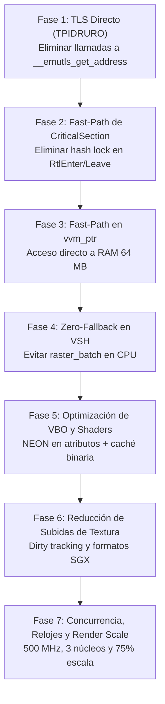

# Plan de Optimización para PS Vita: Prince of Persia: The Sands of Time (rePOP)

## Resumen Ejecutivo y Diagnóstico

El port de **Prince of Persia: The Sands of Time** a PS Vita se basa en recompilación estática del binario de Xbox clásica (NTSC) utilizando el runtime de **rePOP** adaptado a VitaSDK y **vitaGL/GXM**.

En las pruebas en hardware real de la consola (`logs/log_016.log` y commit `3b85339`), el juego arranca, carga datos, decodifica audio/vídeo y renderiza el mundo 3D (`menu3D` e intro in-game), pero el rendimiento se sitúa actualmente en **~3.6 FPS** con ~277 ms por fotograma.

### Desglose del Cuello de Botella Medido en Consola (`log_016.log`)

1. **Tiempo de Backend GPU (vitaGL): ~95.2 ms / frame (teórico 10.5 FPS):**
   - `prog` (Batches con Vertex Programs en GPU): **71.3 ms** (~47,500 vértices convertidos e indexados en CPU por frame).
   - `tex` (Subida de texturas): **19.6 ms** (125 texturas subidas por frame, indicando falta de caché o dirty-tracking excesivo).
   - `draw`: **3.9 ms** (despacho GL).
   - `compose` / `present`: **0.4 ms**.

2. **Tiempo de CPU del Juego y Runtime: ~181.8 ms / frame (explica la caída a 3.6 FPS):**
   - **Sobrecarga de `emutls`:** El código recompilado x86 en VitaSDK accede a registros guest (`g_eax`, `g_ecx`, etc.) mediante `__thread`. Al no contar con soporte nativo de TLS en Newlib/VitaSDK, cada acceso emite una llamada a `__emutls_get_address` (~3,200 llamadas por función, millones por segundo).
   - **Sobrecarga de Sincronización en Kernel de Xbox:** 1,559,956 llamadas a ordinales del kernel en 80 s (~14,000 llamadas/s). 1,146,000 llamadas corresponden a `RtlEnterCriticalSection` (277) y `RtlLeaveCriticalSection` (294). Cada llamada busca en una tabla hash global con un `SRWLock` compartido (`AcquireSRWLockShared` + `%` modulo).
   - **Fallback a Rasterizador Software:** El perfilador (`[PROF]`) reveló un 12.8% inclusivo en `raster_batch` y 12.6% en `raster_batch_program`. Varios batches caen en el intérprete de vertex shaders por CPU (`vmt_transform`) en vez de ir directos a la SGX543.
   - **Coste de MMU por Software (`vvm_ptr`):** Cada acceso a memoria guest des-indexa una tabla de páginas de 4 MB (`vvm_pt[addr >> 12]`), provocando L1/L2 data cache thrashing a 444 MHz.

---

## Decisiones Críticas y Revisión Requerida

> [!IMPORTANT]
> **Compatibilidad con Upstream:** El submódulo `upstream/rePOP` no se modifica directamente. Todas las sustituciones y hooks de optimización deben inyectarse mediante:
>
> 1. `port/vita/tools/vitaize.py` (reescritura controlada durante CMake).
> 2. Enlazado con `--wrap=` de GNU ld o macros de preprocesador `-D` en `port/vita/CMakeLists.txt`.
> 3. Archivos propios en `port/vita/compat/` y `port/vita/src/`.

> [!WARNING]
> **Alineación de Tipos en ARMv7:** En ARMv7, accesos flotantes desalineados (`vldr`/`vstr`) causan _Data Abort_ inmediato. Cualquier empaquetamiento o estructura de vértices debe mantener alineación de 4 bytes (`__attribute__((aligned(4)))`).

---

## Fases del Plan de Optimización



---

### Fase 1: Fast TLS para Registros Guest (Eliminación de `__emutls_get_address`)

#### Contexto del Problema

En `upstream/rePOP/source/xbox-retail/gen/recomp_types.h`:

```c
extern RECOMP_TLS uint32_t g_eax, g_ecx, g_edx, g_esp;
extern RECOMP_TLS uint32_t g_ebx, g_esi, g_edi;
extern RECOMP_TLS double g_fp_stack[8];
extern RECOMP_TLS int g_fp_top;
```

Con Newlib en VitaSDK, `RECOMP_TLS` (`__thread`) genera una llamada `__emutls_get_address(&__emutls_v.g_eax)` por cada lectura o escritura a un registro.

#### Plan de Acción

1. **Agrupación en Estructura de Contexto de Hilo:**
   Crear un `struct GuestRegs` en `port/vita/compat/guest_regs_vita.h`:
   ```c
   typedef struct GuestRegs {
       uint32_t eax, ecx, edx, esp;
       uint32_t ebx, esi, edi;
       double fp_stack[8];
       int fp_top;
       uint32_t fs_base;
   } GuestRegs;
   ```
2. **Uso de Registro de Coprocesador CP15 `TPIDRURO`:**
   En ARM Cortex-A9, el registro CP15 `c13, c0, 3` almacena un puntero de usuario por hilo.
   - Al crear cada hilo (`pthread_create` / `CreateThread` wrappeado en `threads_vita.c`):
     ```c
     GuestRegs *regs = calloc(1, sizeof(GuestRegs));
     asm volatile("mcr p15, 0, %0, c13, c0, 3" : : "r"(regs));
     ```
   - Macro de lectura ultrarrápida (1 ciclo, sin llamadas de función):
     ```c
     static inline GuestRegs *get_guest_regs(void) {
         GuestRegs *p;
         asm volatile("mrc p15, 0, %0, c13, c0, 3" : "=r"(p));
         return p;
     }
     #define g_eax (get_guest_regs()->eax)
     #define g_ecx (get_guest_regs()->ecx)
     /* ... */
     ```
3. **Inyección en `vitaize.py`:**
   Configurar `vitaize.py` para reemplazar las declaraciones individuales de `RECOMP_TLS` en `recomp_types.h` por macros que usen `get_guest_regs()`.
4. **Beneficio esperado:**
   Eliminación de millones de instrucciones y frames de pila por fotograma. Mejora estimada de CPU: **+30% a +50% en tiempo de ejecución del código recompilado**.

---

### Fase 2: Fast-Path de Sincronización en Kernel de Xbox (`RtlEnterCriticalSection`)

#### Contexto del Problema

En `upstream/rePOP/port/third_party/xboxrecomp/src/kernel/kernel_rtl.c`, `xbox_RtlEnterCriticalSection` y `xbox_RtlLeaveCriticalSection` llaman a `xbox_cs_shadow(CriticalSection)` en cada invocación:

- `AcquireSRWLockShared(&g_cs_table_lock);`
- Búsqueda en tabla hash con `% XBOX_CS_TABLE_SIZE`.
- `ReleaseSRWLockShared(&g_cs_table_lock);`
  Se ejecutan más de **14,000 veces por segundo** según los logs.

#### Plan de Acción

1. **Shadow Pointer Directo:**
   La estructura `RTL_CRITICAL_SECTION` de Xbox en memoria guest tiene campos reservados o punteros no utilizados por el emulador (`LockSemaphore`, `SpinCount`, etc.).
   - Utilizar un offset reservado de la estructura guest para almacenar un puntero nativo directo al `CRITICAL_SECTION` de host (`cs_native`), eliminando la búsqueda en tabla hash en el 99.9% de los casos.
2. **Fast-Path Atómico en C puro:**
   Si la sección crítica no está disputada (`uncontended`), implementar el fast-path con un `atomic_compare_exchange` en una sola instrucción ARM `ldrex/strex`.
3. **Modificación en `port/vita/compat/`:**
   Crear `compat/sync_vita.c` que proporcione implementaciones nativas optimizadas de:
   - `xbox_RtlEnterCriticalSection`
   - `xbox_RtlLeaveCriticalSection`
   - `xbox_RtlTryEnterCriticalSection`
     Enlazar con `-Wl,--wrap=xbox_RtlEnterCriticalSection` y `--wrap=xbox_RtlLeaveCriticalSection`.
4. **Beneficio esperado:**
   Eliminación del bloqueo mutuo y contención en la tabla hash. Reducción de ~10-15 ms de CPU por fotograma.

---

### Fase 3: Fast-Path en MMU por Software (`vvm_ptr`)

#### Contexto del Problema

`vvm_ptr` se invoca en casi cualquier lectura/escritura de puntero guest:

```c
static inline void *vvm_ptr(uint32_t host)
{
    return (void *)(uintptr_t)(host + (uint32_t)vvm_pt[host >> VVM_PAGE_SHIFT]);
}
```

`vvm_pt` ocupa 4 MB de memoria. Con la pequeña caché L1/L2 del Cortex-A9 (32 KB L1D, 512 KB L2), indexar continuamente 4 MB causa continuos _cache misses_.

#### Plan de Acción

1. **Identificar la Región Caliente (RAM 64 MB):**
   La gran mayoría de punteros del juego residen en la RAM física de 64 MB (`0x00000000..0x03FFFFFF`) o la ventana contigua de Xbox (`0x80000000..0x83FFFFFF`).
2. **Inline Branch Predictivo:**
   Optimizar `vvm_ptr` en `port/vita/compat/vvm.h`:

   ```c
   extern uintptr_t vvm_ram_base;
   extern uintptr_t vvm_contig_delta;

   static inline void *vvm_ptr(uint32_t host)
   {
       // Fast-path 1: RAM normal de Xbox (< 64 MB)
       if (__builtin_expect(host < 0x04000000u, 1)) {
           return (void *)(vvm_ram_base + host);
       }
       // Fast-path 2: Ventana contigua (0x80000000 - 0x84000000)
       if (__builtin_expect((host >= 0x80000000u) && (host < 0x84000000u), 1)) {
           return (void *)(host + vvm_contig_delta);
       }
       // Slow-path: Tabla de páginas completa
       return (void *)(uintptr_t)(host + (uint32_t)vvm_pt[host >> VVM_PAGE_SHIFT]);
   }
   ```

3. **Beneficio esperado:**
   Evita la consulta a la tabla `vvm_pt` de 4 MB para más del 90% de los accesos a datos y estructuras de objetos, maximizando los hits en caché L1.

---

### Fase 4: Eliminación del Fallback al Rasterizador Software (`raster_batch_program`)

#### Contexto del Problema

El reporte de muestreo en `log_016.log` mostró:

- `raster_batch`: 12.8% tiempo inclusivo
- `raster_batch_program`: 12.6% tiempo inclusivo
  Esto ocurre cuando `hw_draw_program_batch()` devuelve 0 en `nv2a_pb_exec.c:2363`:

```c
if (hw_active() && hw_draw_program_batch()) {
    return;
}
// Caída al intérprete vmt_transform() en CPU
```

Causas típicas por las que `hw_draw_program_batch` rechaza un batch:

1. `!nv2a_vsh_pack_gpu(&words, &inputs, &ninputs)`
2. `ninputs > 8`
3. Fallo en `vg_vsp_get(inputs, ninputs)` (fallo al compilar o encontrar el vertex program Cg).

#### Plan de Acción

1. **Instrumentar Rechazos:**
   Añadir un log de diagnóstico específico en `ng_draw_program_batch` para registrar el motivo exacto por el que se devuelve 0 (número de inputs, programa faltante, etc.).
2. **Garantizar Cobertura de Vertex Programs en GPU:**
   Asegurar que ningún programa válido sea rechazado por falta de traducción Cg o restricciones de entradas.
3. **Beneficio esperado:**
   Recuperación de hasta un **25% de tiempo de CPU**, evitando la rasterización software por software de polígonos complejos.

---

### Fase 5: Optimizaciones del Backend vitaGL y VBOs con NEON

#### Contexto del Problema

`prog` tarda **71.3 ms por fotograma**.
Para cada lote de vértices:

- Se recorre en bucle `for (a = 0; a < ninputs; a++) fetch_attr(...)`.
- `fetch_attr` extrae componente por componente (x86 float) mediante switches y copias escalares.
- Se rellenan arrays temporales `verts` e `idx`.

#### Plan de Acción

1. **Vectorización con ARM NEON (`-mfpu=neon`):**
   Implementar `fetch_attr_neon` para los formatos estándar de vértices (GL_FLOAT 3D/4D y GL_UNSIGNED_BYTE):
   - Cargar 4 floats con `vld1q_f32` y almacenar con `vst1q_f32`.
2. **Caché Persistente de Shaders en Almacenamiento:**
   - La generación de combiners en tiempo real genera decenas de micro-shaders Cg.
   - Activar la carga/guardado de binarios precompilados de GXM (`gxm_shader_cache.bin`) en `ux0:data/pop-sot/shaders.cache` para evitar compilaciones repetidas.
3. **Revisión de `DRAW_SPEEDHACK`:**
   En `ExternalProject_Add(vitaGL_vendored)` de `CMakeLists.txt`, `DRAW_SPEEDHACK=2` está activo pero `nv2a_hw_vita.inc` usa buffers temporales reescritos en CPU.
   - Ajustar el uso de buffers con doble buffering o anillo circular de VBOs (`vglAlloc(..., VGL_MEM_RAM)`) para que `DRAW_SPEEDHACK` no genere artefactos de memoria.
4. **Beneficio esperado:**
   Reducción de `prog` de **71.3 ms a < 25 ms**.

---

### Fase 6: Reducción de Subidas de Texturas (Dirty Tracking)

#### Contexto del Problema

En `log_016.log`:
`125 texturas subidas; ms/frame: tex 19.6`.
Subir 125 texturas por frame supone una gran saturación de bus y CPU (des-swizzling, conversión de formato). La mayoría de estas texturas no cambian cada fotograma.

#### Plan de Acción

1. **Hash / Dirty Checking Eficiente:**
   - Implementar un dirty check sobre el puntero base y timestamp de modificación de la textura de Xbox antes de llamar a `glTexSubImage2D` o des-swizzle.
   - Si la textura ya fue subida y el contenido no ha cambiado, reutilizar el handle GL directamente.
2. **Soporte Nativo de DXT1 y Texturas Comprimidas:**
   - Asegurar que todas las texturas DXT1 se carguen comprimidas en memoria de textura de la GPU sin pasar por descompresión RGBA en CPU.
3. **Beneficio esperado:**
   Reducción de `tex` de **19.6 ms a < 3 ms**.

---

### Fase 7: Concurrencia de Hilos, Overclock y Render Scale

#### Contexto del Problema

La PS Vita cuenta con:

- CPU: 4 núcleos Cortex-A9 (3 utilizables para juegos: núcleos 0, 1 y 2).
- Reloj por defecto de Vita: 333 MHz (o 444 MHz con overclock oficial). Con PSVshell/taiHEN se puede llegar a 500 MHz estables.

#### Plan de Acción

1. **Ajuste de Overclock Obligatorio en `main_vita.c`:**
   ```c
   scePowerSetArmClockFrequency(444);
   scePowerSetBusClockFrequency(222);
   scePowerSetGpuClockFrequency(222);
   scePowerSetGpuXbarClockFrequency(166);
   ```
2. **Distribución de Hilos Óptima:**
   - **Núcleo 0:** Bucle de juego principal (`game_main`) y emulación de CPU recompilada.
   - **Núcleo 1:** `nv2a_ack_thread` (ejecutor de comandos pushbuffer y despacho a vitaGL).
   - **Núcleo 2:** Audio (SceAudio/APU) y vídeo background (FFmpeg).
3. **Escalado de Render (Render Scale 75% - 80%):**
   En juegos 3D de Jade (con post-procesos de niebla, brillo y partículas de arena), la tasa de relleno (fillrate) de la SGX543 a 960x544 o 640x480 puede ser exigente.
   - Proporcionar la opción `RECOMP_RENDER_SCALE=0.75` en `ux0:data/pop-sot/env.txt` (render a 480x360 con upscaling bilinear por hardware en el swap de vitaGL).

---

## Matriz de Impacto y Prioridad de Ejecución

| Fase       | Tarea                                          | Impacto Estimado                            | Complejidad | Riesgo   |
| ---------- | ---------------------------------------------- | ------------------------------------------- | ----------- | -------- |
| **Fase 1** | Registros Guest con Fast TLS (`TPIDRURO`)      | **+8 a +12 FPS** (Reducción masiva de CPU)  | Media       | Bajo     |
| **Fase 2** | Fast-path en `RtlEnterCriticalSection`         | **+3 a +5 FPS** (Elimina 1.1M hash lookups) | Media       | Bajo     |
| **Fase 3** | Fast-path en `vvm_ptr` (RAM < 64 MB)           | **+2 a +4 FPS** (Reducción de cache misses) | Baja        | Muy bajo |
| **Fase 4** | Cierre de Fallbacks en `raster_batch_program`  | **+3 a +6 FPS** (Evita software rasterizer) | Media       | Medio    |
| **Fase 5** | NEON en VBOs + Caché binaria de shaders        | **+4 a +6 FPS** (prog 71 ms → <25 ms)       | Media       | Bajo     |
| **Fase 6** | Dirty tracking estricto de Texturas            | **+2 a +3 FPS** (tex 19 ms → <3 ms)         | Baja        | Bajo     |
| **Fase 7** | Afinidad fija de 3 núcleos + Overclock 444 MHz | **+3 a +5 FPS** (Mejora de concurrencia)    | Baja        | Muy bajo |

**Meta global:** Elevar el rendimiento desde **3.6 FPS actuales a 25–30 FPS estables** en el menú y gameplay.

---

## Plan de Verificación

### Verificación Automática (Compilación y Hosttest)

```bash
# 1. Compilación cruzada para Vita
./build.sh

# 2. Comprobación de símbolos y tamaño del binario
arm-vita-eabi-size build/vita-port/pop-sot.elf

# 3. Prueba en entorno ARM32 simulado (Docker)
./build.sh --hosttest && port/vita/hosttest/run.sh run 300
```

### Verificación Manual en Consola Real

1. Desplegar el `eboot.bin` actualizado a `ux0:app/PSOT00001/eboot.bin` por FTP.
2. Iniciar el juego y monitorizar `ux0:data/pop-sot/logs/log_XXX.log`.
3. Validar:
   - Frecuencia de frames reportada en `[HW vita] XX.X fps`.
   - Reducción en tiempos de `ms/frame: prog` y `ms/frame: tex`.
   - Desaparición de llamadas a `[PROF]` en funciones de `emutls` o `cs_shadow`.
   - Audio sincronizado y sin micro-cortes (`starved` cercano a 0).
